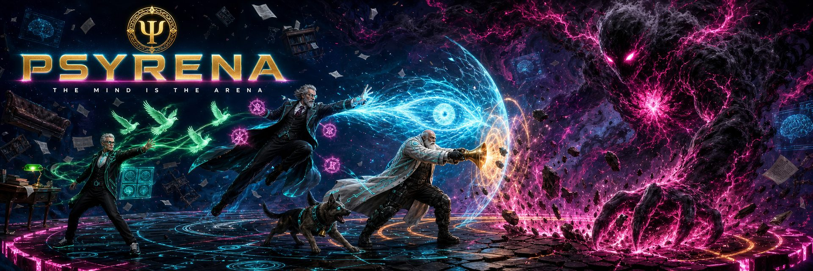

# PSYRENA

*psy- + arena. Pronounced "sy-REE-nah".*

**Made by Frank Ye.**

**Psyrena is a browser-based 3D co-op boss-fighting RPG in which every playable hero
is a famous psychologist and every skill is that psychologist's actual theory.**

Teams of 3–5 players gear up in a small urban village, queue for instanced boss
fights, and battle abstract psychological constructs (The Regressor, Cognitive
Distortion, Burnout) with WoW-style raid mechanics: roles, cooldowns, telegraphs,
buffs and debuffs. Bosses move through *psychological phases*, and the counter to
each phase is the matching piece of real theory. When the boss regresses to
infancy, you cast Freud's **Oral Stage**. When a crisis of trust opens, you resolve
Erikson's **Trust vs. Mistrust**. Ring Pavlov's bell at the conditioned moment.

It's a raid game that accidentally teaches Psych 101.

## Built for a class

Psyrena is used in the author's undergraduate psychology courses. Students play it
on their own phones and laptops, in the browser, with no install; and students help
build it. Hero kits, boss designs, quiz items, art prompts and balancing notes all
come in through the contribution lanes in [CONTRIBUTING.md](CONTRIBUTING.md), and
you do not need to be a programmer to take one. You need to know your theorists.

Three commitments follow from that setting, and they are enforced in the code as
well as in the rules:

- **Contributing is voluntary.** For students in the author's courses, contributing
  is not graded, not required, and never affects marks in either direction.
- **No monetization, ever.** No purchases, no ads, no currency convertible to money.
  Nothing a student builds is ever sold.
- **Accounts exist so a class can play together.** When a class invitation code is
  used at registration, the game asks for a student ID so the instructor can match
  accounts to the roster. Any research involving players or contributors runs under
  separate ethics approval and consent, never as a condition of playing or
  contributing.

The project is also the subject of academic writing on game-based learning and on
students co-designing the games they learn from. This repository is what that
writing points to.

## How it plays

- **Theory is the mechanic.** Master a hero and you can pass a quiz question about
  their theory. Freud's kit is his five psychosexual stages on a skill palette,
  defense mechanisms on a cooldown, and an Id → Ego → Superego stance you switch by
  hand; choosing which agency of the mind is in charge is the damage rhythm.
- **Skill beats gear, always.** Full best-in-slot gear is worth +12%. Reading the
  boss correctly is worth ~340%. A day-one player who answers the phase right
  out-damages a geared player who doesn't.
- **Compete without PvP.** Teams never attack each other. Two teams can race
  mirrored copies of the same boss for score, leaderboards, titles, and seasonal
  cosmetics.
- **2026 aesthetic.** Techwear, AR visors, drones, holographic UI. No swords.

## Current state

An early playable slice: the **village hub** (social scene) and the first boss
arena scaffold, with the first hero, **Freud, The Analyst**, walkable in the hub.

- WASD / touch-stick movement with camera orbit, jumping, and solid-object collision
- Full skill bar (five stage skills, Defense Mechanism, Free Association, Dream
  Analysis) with cast gestures, VFX, and voice lines
- Manual Id / Ego / Superego stance switching (Tab, or the stance button on touch)
- A living plaza: shops, pet park, practice booth, NPCs, and crowd, all AI-generated
  3D assets (Tripo) run through a documented budget-conscious pipeline
- WebGPU renderer with a WebGL2 fallback, 60 fps on mid-range hardware

## Running it

```bash
npm install
npm run dev        # vite dev server
npm run build      # typecheck + production build
```

`npm run dev` seeds four fixture accounts (`frank`, `jung`, `adler`, `horney`, all
with the password `psyrena123`) plus two joinable rooms. They exist only in dev; a
production boot never creates an account. The Puppeteer scripts
(`tools/probe/*check.mjs`, `tools/*-e2e.mjs`) log in as `frank` by default and read
`PSYRENA_USER` / `PSYRENA_PW` / `PSYRENA_URL` to point somewhere else.

Open the printed URL in a modern browser. Desktop keys: **WASD** move, **Shift**
run, **Space** jump, **1–5 / Q / E / R / F** skills, **Tab** stance, drag to orbit,
wheel to zoom. On a touch device the UI switches to a thumb-stick and skill cluster
automatically.

### Deploying

`npm run build && npm run server` is a complete origin: `server/index.mjs` serves
`/api/*` and the `dist/` build from one process (port `PORT`, default 8787). Put
Cloudflare or another CDN/TLS proxy in front and set:

```bash
PSYRENA_SECURE_COOKIES=1   # session cookie carries Secure (any HTTPS deploy)
PSYRENA_TRUST_PROXY=1      # rate limiting reads CF-Connecting-IP / X-Forwarded-For
PSYRENA_DB=/var/psyrena/psyrena.db   # database location (back this file up)
```

Two gitignored asset trees must be regenerated on the deploy box before the build:
`npm run assets:ktx2` (compressed textures) and the sound-effect sync from a local
`psfx/` checkout (see `tools/`). `GET /api/health` is the liveness probe.

Production never seeds accounts; players sign up in the client
(`POST /api/register`). The first account registered on a fresh database is
promoted to admin automatically, so register your own account before you hand out
the URL, or set `PSYRENA_ADMIN=<username>` at boot to promote an existing one. The
admin console lives at `/admin`: user management, invitation codes, gift codes,
chat moderation, reports and statistics.

## Tech

- [Babylon.js 8](https://www.babylonjs.com/), WebGPU first, WebGL2 fallback
- TypeScript + Vite; plain DOM for all UI (no engine GUI)
- KTX2/UASTC compressed textures, hardware instancing, a hard per-scene GPU budget
- Node server with SQLite; sessions in HttpOnly cookies, passwords hashed with scrypt

## Tools used to make this game

Psyrena was built by one person with a heavy AI-assisted pipeline. Design, code,
art, 3D and voice all pass through generation tools, then through a
budget-conscious offline pipeline, before anything ships.

| Area | Tools |
|---|---|
| **Author** | Frank Ye |
| **Code & architecture** | Claude (integration, KTX2 pipeline, engine wiring), Grok / xAI coding agents, Kimi-k3, Hermes, [Ollama](https://ollama.com/) (local LLM inference) |
| **Concept art** | [Grok Imagine](https://x.ai/) (hero / village / arena sheets), [Civitai](https://civitai.com/) orchestration + gpt-image-2 (boss, gear, achievements, practice) |
| **3D models** | [Tripo](https://www.tripo3d.ai/) (image/multiview → model, auto-rig, retarget, decimate) |
| **Character rigs & animation** | [Mixamo](https://www.mixamo.com/), Mesh2Motion, Blender (NLA clip exports where needed) |
| **Mesh / texture post** | [glTF-Transform](https://gltf-transform.dev/), `toktx` (KTX2/UASTC), custom scripts under `tools/` |
| **Voice** | Qwen3-TTS (runtime packs); the shipped `.mp3` packs live under `public/assets/*/voice/` |
| **Music / OST** | [Suno](https://suno.com/) Pro (village + boss soundtrack, `public/assets/*/ost/`) |
| **Sound effects** | [PSFX — Peri's Sound Effects](https://github.com/JimHPerry/psfx) by Peri Eskell (non-commercial license; not redistributed here; `tools/sync-sfx.mjs` copies the chosen sounds from a local clone) |
| **Engine / client** | Babylon.js 8, TypeScript, Vite |
| **Verification** | Puppeteer screenshot / e2e scripts (`tools/probe/*`, `tools/*-e2e.mjs`) |

## Contributing

Read [CONTRIBUTING.md](CONTRIBUTING.md) first. It lists the lanes (hero design, boss
design, code, 3D assets and VFX, balancing and playtesting, quiz content), the
ground rules, and how credit works: every merged contributor appears in the in-game
credits, and substantial contributions are acknowledged in publications about the
project.

## What is not in this repo

This is the public game repository. Three trees are kept private and are
deliberately absent:

- **`docs/`**: the design bible, with the combat system, hero kits, boss scripts,
  open design issues and generation prompts. Source comments cite it by number
  (`docs/09 §2`, `docs/04-bosses.md`). Those citations are internal references, not
  broken links, and nothing here needs the files to build or run.
- **`assets/concept/`**: concept art, trailer storyboards and the prompts behind them.
- **`assets/work/`**: raw production material and per-asset runbooks, meaning source
  meshes, un-decimated models, raw voice `.wav` takes and texture plates.

What ships is the finished output of that pipeline, under `public/assets/`.
Everything in `tools/` that regenerates an asset writes back into `assets/work/` and
will not run without it; those scripts are kept as documentation of how each asset
class was made.

One deliberate exception: `admin/boss-math/` is a design-time tuning sheet whose
`extracted-stats.json` snapshots combat numbers with their provenance, including
values and open issues taken from the private design bible. It is public on purpose,
because the designer's side of the process is part of what this repository
documents.

`tools/verify-hero-budget.mjs` skips cleanly when the boss-math export is missing.
Point it at your own with `PSYRENA_BOSS_MATH=/path/to/export.json`.

## License

Psyrena is source-available for non-commercial use. It is not open source in the
OSI sense, and that is deliberate: the code is public so that students and other
teachers can read, run, study and extend it, not so that it can be sold.

- **Code**: [PolyForm Noncommercial 1.0.0](LICENSE). Any non-commercial purpose is
  permitted, and use by an educational institution or public research organization
  counts as non-commercial regardless of how it is funded.
- **Assets**: [CC BY-NC 4.0](LICENSE-ASSETS.md). Attribution required, non-commercial
  only. This covers everything under `public/assets/` and the generated model data
  in `src/proceduralFreud/`.

Sound effects are the exception: PSFX is non-commercial-licensed and is not
redistributed here at all. See [LICENSE-ASSETS.md](LICENSE-ASSETS.md) for the full
breakdown, including the generation-tool terms behind the music and models.
Commercial licensing, or a use that does not fit these terms, is available on
request; open an issue or contact the author.
